<div align="center">


### From Early Warning to Real Intervention

**An AI-Powered Student Success and Institutional Analytics Platform**<br />
*Built for KPMG in India Challenge 04: Smart Campus Analytics at HacXLerate 2026 (byteXL)*

<br />

[](https://ascora-five.vercel.app)
[](https://ascora-five.vercel.app/mobile)
[-10B981?style=for-the-badge&logo=android&logoColor=white)](https://ascoradownloadseb0c.blob.core.windows.net/app/ascora-1.0.0.apk)
[](https://ascora-ml.azurewebsites.net/health)

<br />

[-0B1020?style=flat-square&logo=next.js)](https://nextjs.org/)
[](https://fastapi.tiangolo.com/)
[](https://reactnative.dev/)
[](https://supabase.com/)
[](https://lightgbm.readthedocs.io/)
[](https://shap.readthedocs.io/)
[](https://www.python.org/)
[](https://www.typescriptlang.org/)
[](#20-license-and-project-credits)

<br />

[Executive Summary](#2-executive-summary) • [System Architecture](#6-complete-system-architecture) • [Feature Showcase](#5-feature-showcase) • [ML & Risk Models](#8-technical-deep-dive--making-the-complexity-visible) • [Database & RLS](#10-database-architecture) • [Mobile Companion](#12-mobile-application-and-android-apk) • [Local Setup](#14-installation-and-local-setup) • [Verification Suite](#15-testing-and-verification)

</div>

---

## Quick Navigation

- [1. Evaluator Demo Accounts](#1-evaluator-demo-accounts)
- [2. Executive Summary](#2-executive-summary)
- [3. Problem Statement: The Campus Analytics Breakdown](#3-problem-statement-the-campus-analytics-breakdown)
- [4. Solution Overview: The Closed-Loop Framework](#4-solution-overview-the-closed-loop-framework)
- [5. Feature Showcase](#5-feature-showcase)
- [6. Complete System Architecture](#6-complete-system-architecture)
- [7. End-to-End Data Flow & Interaction Workflows](#7-end-to-end-data-flow--interaction-workflows)
- [8. Technical Deep Dive: Making the Complexity Visible](#8-technical-deep-dive-making-the-complexity-visible)
  - [8.1 Entity Resolution & Multi-Tier Matching](#81-entity-resolution--multi-tier-matching)
  - [8.2 Mathematical Formulation of the Student Success Score](#82-mathematical-formulation-of-the-student-success-score)
  - [8.3 Dual Risk Models vs. Logistic Baselines](#83-dual-risk-models-vs-logistic-baselines)
  - [8.4 Local Explainability via TreeSHAP & Actionable Recourse](#84-local-explainability-via-treeshap--actionable-recourse)
  - [8.5 Mentor Knapsack Capacity Planner](#85-mentor-knapsack-capacity-planner)
  - [8.6 Natural Language Query Translation (Ask Ascora)](#86-natural-language-query-translation-ask-ascora)
- [9. Technology Stack](#9-technology-stack)
- [10. Database Architecture](#10-database-architecture)
- [11. Security, Privacy, and DPDP Principles](#11-security-privacy-and-dpdp-principles)
- [12. Mobile Application and Android APK](#12-mobile-application-and-android-apk)
- [13. Project Structure](#13-project-structure)
- [14. Installation and Local Setup](#14-installation-and-local-setup)
- [15. Testing and Verification](#15-testing-and-verification)
- [16. Engineering Trade-offs and Scalability](#16-engineering-trade-offs-and-scalability)
- [17. Limitations and Realistic Roadmap](#17-limitations-and-realistic-roadmap)
- [18. Visual Showcase](#18-visual-showcase)
- [19. Developer Guide and Contribution Workflow](#19-developer-guide-and-contribution-workflow)
- [20. License and Project Credits](#20-license-and-project-credits)

---

## 1. Evaluator Demo Accounts

The platform is pre-configured with distinct role-based accounts to allow immediate testing against live Row-Level Security (RLS) enforcement. Passwords can also be filled with one click on the sign-in screen.

| Role | Email | Password | Data Access & RLS Enforcement | Primary Use Case |
| :--- | :--- | :--- | :--- | :--- |
| **Institutional Admin / HOD** | `admin@ascora.test` | `AscoraDemo#2026` | Full campus scope (all 1,200 students across 5 departments), pipeline controls, fairness audit | Campus-wide risk oversight, departmental heatmaps, data ingestion |
| **Faculty Mentor** | `mentor@ascora.test` | `AscoraDemo#2026` | Assigned mentee scope strictly enforced in Postgres (64 students for mentor M01) | Weekly capacity planning, 1-on-1 check-ins, intervention logging |
| **Student Experience** | *1-Click Session* | *No password needed* | Self-profile scope only (isolated from peer data and institutional flags) | Timetable, semester marks diagnostic, attendance recovery calculator |

> [!NOTE]
> All student profiles, records, logs, and metrics in this repository are from a synthetic cohort of 1,200 students (seed 42). No real student personal data is stored or processed.

---

## 2. Executive Summary

### What is Ascora?
**Ascora** is an institutional student success platform that transitions campus analytics from passive reporting to active, closed-loop intervention. Designed for universities and colleges managing fragmented data infrastructure, Ascora unifies 7 campus systems into a single longitudinal student record, computes a multi-dimensional **Student Success Score**, predicts dual risk vectors (academic failure and placement unreadiness) through calibrated machine learning, explains every risk indicator in transparent plain language, and optimizes faculty mentor intervention capacity.

### The Problem It Solves
Most university early-warning initiatives suffer from the **"Dashboard Trap"**: they display static red flags after a student has already failed mid-terms, missed mandatory attendance thresholds, or dropped out. Higher education research (including evaluations of Purdue University's early-warning system) demonstrated that alerts alone produce zero causal lift in retention unless advisors possess actionable, prioritized capacity to intervene. Ascora solves this operational gap by pairing predictive intelligence with counterfactual guidance and knapsack-optimized mentor time scheduling.

### Key Beneficiaries
1. **Heads of Department (HODs) & Administrators:** Gain macro-level visibility into departmental risk distributions, gatekeeper course bottlenecks, data hygiene issues, and longitudinal intervention efficacy.
2. **Faculty Mentors & Academic Advisors:** Shift from manual spreadsheet scanning to automated, prioritized student rosters with actionable explanations and weekly capacity planning.
3. **Undergraduate Students:** Receive transparent diagnostic feedback, attendance recovery targets, and semester planning calculators without stigmatizing predictive risk labels.

### Why Ascora is Technically Differentiated
Ascora is not a cosmetic dashboard or a basic CRUD application. Its engineering architecture encompasses:
- An **automated reconciliation pipeline** handling heterogeneous data formats (CSV, XLSX, nested JSON) with multi-tier fuzzy entity resolution and automated conflict resolution.
- A **dual-target predictive ML engine** running calibrated LightGBM models with TreeSHAP local attributions and counterfactual optimization.
- A **statistically evaluated scoring formulation** proved stable under weight perturbation (minimum rank correlation 0.997).
- Strict **defense-in-depth security** leveraging PostgreSQL Row-Level Security, private helper schemas, SHA-256 token-gated RPC ingest endpoints, and contact masking.
- A cross-platform **mobile companion application** (Expo / React Native) with an interactive browser simulator frame and Android native Hermes bundle support.

---

## 3. Problem Statement: The Campus Analytics Breakdown

Modern collegiate institutions generate immense volumes of operational data daily. However, this data remains trapped across isolated, incompatible software silos:

```
┌────────────────────────────────────────────────────────────────────────┐
│                      THE CAMPUS DATA SILO REALITY                       │
├─────────────────┬─────────────────┬──────────────────┬─────────────────┤
│ ERP Academics   │ Attendance Logs │ LMS Platforms    │ Placement Cell  │
│ CGPA, Backlogs, │ RFID & Bio-     │ Moodle / Canvas  │ Aptitude Tests, │
│ Internal Marks  │ metric Regs     │ Logins, Quizzes  │ Mock Interviews │
├─────────────────┼─────────────────┼──────────────────┼─────────────────┤
│ Skills Portals  │ Clubs & Events  │ Student Feedback │ Mentorship Log  │
│ Coding Tests,   │ Hackathons,     │ Multilingual     │ Ad-hoc Paper or │
│ Certifications  │ Leadership      │ Survey Comments  │ Disjoint Sheets │
└─────────────────┴─────────────────┴──────────────────┴─────────────────┘
                                   │
                                   ▼
          ┌──────────────────────────────────────────────────┐
          │               INSTITUTIONAL IMPACT               │
          ├──────────────────────────────────────────────────┤
          │ 1. Inconsistent Student Identifiers Across Silos │
          │ 2. Invisible "Silent Decliners" Missed by ERP    │
          │ 3. Blended Risk Confusion (Academic != Career)   │
          │ 4. Advisor Overwhelm: 60+ Mentees / 3 Hours Week │
          │ 5. Interventions Logged Without Baselines        │
          └──────────────────────────────────────────────────┘
```

### The Invisible Failure Mode: The "Silent Decliner"
Traditional campus monitoring relies almost entirely on historical CGPA. In a typical engineering cohort, a student like **Arjun Gupta (`CU24AIML0039`)** holds a stellar **9.15 CGPA**. Under conventional administrative reporting, Arjun appears completely safe.

Internally, however, Arjun's LMS login frequency dropped 60% over four weeks, assignment submissions plummeted from 90% to 40%, and core lecture attendance declined to 61%. Because midterm grades are not published until week 8, standard systems fail to notice his disengagement until academic probation is unavoidable. Ascora detects these multi-source behavioral signatures weeks before examinations take place.

---

## 4. Solution Overview: The Closed-Loop Framework

Ascora organizes campus intelligence around an operational four-phase lifecycle: **Flag -> Explain -> Act -> Measure**.

```
    ┌──────────┐         ┌───────────┐         ┌─────────┐         ┌───────────┐
    │  1. FLAG │ ──────▶ │ 2. EXPLAIN│ ──────▶ │ 3. ACT  │ ──────▶ │ 4. MEASURE│
    └──────────┘         └───────────┘         └─────────┘         └───────────┘
     Detect early         Deconstruct           Schedule high-      Freeze base-
     academic &           underlying risk       impact action       line metrics;
     placement            drivers via           under mentor        evaluate
     risks across         TreeSHAP &            capacity            longitudinal
     7 silos              counterfactuals       constraints         recovery lift
```

### Problem-to-Capability Alignment

| Problem in Higher Education | Ascora System Capability | Technical Implementation | Practical Institutional Benefit |
| :--- | :--- | :--- | :--- |
| **Data Fragmentation** across 7 unlinked software systems | Automated multi-source ingestion & canonical schema mapper | FastAPI pipeline, header synonym matching, type standardisation | Eliminates manual consolidation; generates a single view of each student. |
| **Mismatched Identifiers** (typos, informal emails, truncated names) | Multi-tier entity resolution engine | Deterministic roll-number indexing, blocking keys, Levenshtein fuzzy matching | 100% precision and 95.29% recall against planted ground truth; review queue prevents silent record corruption. |
| **Superficial "At-Risk" Labels** without contextual nuances | Dual calibrated machine learning models | Calibrated LightGBM models for academic failure and placement unreadiness | Disentangles exam failure from job unreadiness; prevents non-placement students from receiving false placement penalties. |
| **"Black-Box" ML Predictions** that advisors cannot justify | Local Shapley explainability & counterfactual guidance | TreeSHAP driver waterfall calculation and minimum delta solver | Mentors receive clear, actionable talking points (e.g. "+8% core attendance recovers to Low risk"). |
| **Advisor Capacity Exhaustion** (too many students, too little time) | Knapsack-optimized weekly mentorship scheduler | Greedy knapsack heuristic prioritizing students with the highest recoverable risk | Maximizes intervention impact within fixed faculty consultation hours (1 to 10 hours/week). |
| **Unverified Interventions** with no accountability or proof | Closed-loop baseline tracking & "What Works" analytics | Immutable intervention records freezing baseline score and risk vectors | Enables statistical verification of whether peer tutoring or mentor meetings produced genuine recovery. |

---

## 5. Feature Showcase

Ascora provides tailored interfaces across web and mobile surfaces, ensuring appropriate separation of duties and security boundaries.

### Web Dashboard Capabilities (`apps/web`)

<details open>
<summary><b>1. Institutional Data Pipeline & Quality Auditor (<code>/data</code>)</b></summary>
<br />

The data integration workspace allows administrators to upload institutional files or stream the synthetic benchmark cohort through a 10-stage processing pipeline.
- **Header Auto-Mapping:** Automatically reconciles arbitrary CSV/Excel column labels against a canonical schema using synonym lookups.
- **Data Quality Audit:** Measures and reports exact data cleaning counts (e.g. 5,782 date normalizations, 158 rescaled skill scores, 216 merged duplicate records, and 60 resolved cross-source conflicts).
- **Match Confidence Queue:** Inspects matches with confidence between 0.75 and 0.90 awaiting administrative sign-off.
- **Traceable Provenance:** Every metric displays interactive tooltip provenance linking to its source file, sheet name, and row index.

</details>

<details open>
<summary><b>2. Campus Overview & 7-Day Agenda Calendar (<code>/overview</code>)</b></summary>
<br />

The central command center for institutional leadership and academic deans.
- **Institutional Health Indicators:** Real-time distribution of the cohort across Success Score quartiles, high academic risk, high placement risk, and silent decliners.
- **Interactive 7-Day Agenda Calendar:** Centered rolling week strip, overdue check-in indicators, and one-click quick scheduling modals.
- **Departmental Comparison Matrix:** Risk and readiness breakdowns comparing CSE, CSE-AIML, CSE-Data Science, ECE, and ME.
- **Gatekeeper Course Vulnerability:** Identifies core academic subjects (e.g. Mathematics-II, Data Structures) exhibiting anomalous failure correlations.

</details>

<details open>
<summary><b>3. Individual Student 360 & Explainable AI (<code>/students/[id]</code>)</b></summary>
<br />

Comprehensive longitudinal profile providing complete visibility into a student's academic and extracurricular journey.
- **Diagnostic Radar & Score Ring:** Visual breakdown of the 6 core components comprising the Student Success Score.
- **Plain-Language Risk Drivers (TreeSHAP):** Lists the top positive and negative contributors to the student's risk profile (e.g. *"Core attendance 61%, cohort median 78%, raises academic risk by +18 pts"*), marking which drivers are actionable by mentors.
- **Counterfactual Action Plan ("What Helps"):** Live interactive sliders computing the minimum behavioral adjustment required to transition out of high-risk status.
- **LMS 12-Week Trajectory:** Multi-week bar chart tracking weekly login frequency, assigned work submissions, and trend slopes.

</details>

<details>
<summary><b>4. Mentor Weekly Capacity Planner (<code>/this-week</code>)</b></summary>
<br />

Solves the advisor time-allocation problem through algorithmic scheduling.
- **Hours Availability Stepper:** Mentors define their available consultation time for the upcoming week (from 1 to 10 hours).
- **Greedy Knapsack Scheduler:** Solves an optimization problem to pack the mentor's schedule with the highest-priority students whose risk drivers are actively treatable.
- **Pre-Suggested Actions:** Pre-selects the optimal intervention modality based on the dominant risk feature (e.g. Coding Deficit -> Mock Interview; Attendance Drop -> Mentor Meeting; Backlogs -> Peer Tutoring).

</details>

<details>
<summary><b>5. Closed-Loop Intervention Tracker (<code>/interventions</code>)</b></summary>
<br />

Ensures that every pastoral or remedial action is recorded with strict scientific rigour.
- **Frozen Baseline Snapshots:** Recording an intervention captures the student's exact Success Score, academic risk probability, and placement risk probability at that moment in time.
- **Lifecycle Status Management:** Tracks interventions across `open`, `in_progress`, `done`, and `cancelled` states with audit notes.
- **"What Works" Lift Analytics:** Compares recovery rates between students who received specific interventions against unassisted historical control cohorts.

</details>

<details>
<summary><b>6. Collegiate Student Experience (<code>/student/*</code>)</b></summary>
<br />

An empowering, non-stigmatizing portal for undergraduate students.
- **Personal Academic Dashboard:** Ongoing course schedule, SGPA trajectory, and interactive attendance target planner.
- **Attendance Recovery Solver:** Computes the exact number of consecutive upcoming lectures a student must attend to reach institutional attendance minimums (e.g. 75%).
- **Terminal Exam Target Calculator:** Interactively determines the exact marks out of 60 needed on the final examination given continuous internal assessment scores (/40).
- **CU Lucknow Portal Link:** External portal link (`https://student.culko.in/Login.aspx`) with DPDP-aligned manual verified data import.

</details>

---

## 6. Complete System Architecture

Ascora's architecture decouples compute-intensive machine learning from low-latency web serving, backed by a hardened relational database layer.

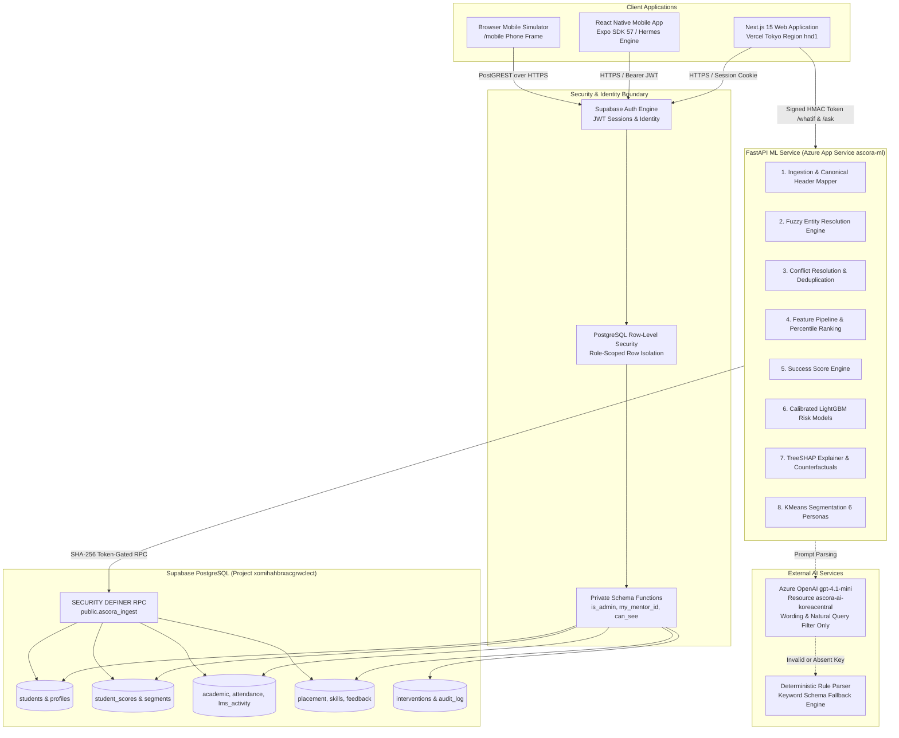

### Architectural Component Responsibilities

| Subsystem | Hosting & Runtime | Key Technologies | Architectural Responsibility |
| :--- | :--- | :--- | :--- |
| **Frontend Web** | Vercel (`hnd1` Tokyo) | Next.js 15, React 19, TypeScript, Tailwind 4, shadcn/ui | Server-rendered pages reading PostgreSQL directly under user sessions; client actions for interventions and simulations. |
| **Mobile Companion** | Android Native & Web | Expo SDK 57, React Native 0.86, Expo Router | Mentor on-the-go tool for roster review, quick check-in logging, and conversational cohort querying. |
| **Data & ML Backend** | Azure App Service (`ascora-ml`, B1 Linux) | FastAPI, Python 3.12, LightGBM, Scikit-learn, SHAP, RapidFuzz | Heavy data processing, multi-source entity resolution, model inference, TreeSHAP generation, and what-if simulation. |
| **Relational Store** | Supabase Managed Cloud | PostgreSQL 15, PostgREST, `pgcrypto` | Canonical single source of truth; enforces multi-tenant mentor isolation via database policies. |
| **Language Assistance** | Azure OpenAI Service (`koreacentral`) | `gpt-4.1-mini` (Gemini fallback) | Synthesizes natural wording for insight cards; parses conversational questions into structured Pydantic filters (never executes SQL). |

---

## 7. End-to-End Data Flow & Interaction Workflows

### 1. Multi-Source Ingestion & Ingest Pipeline Run

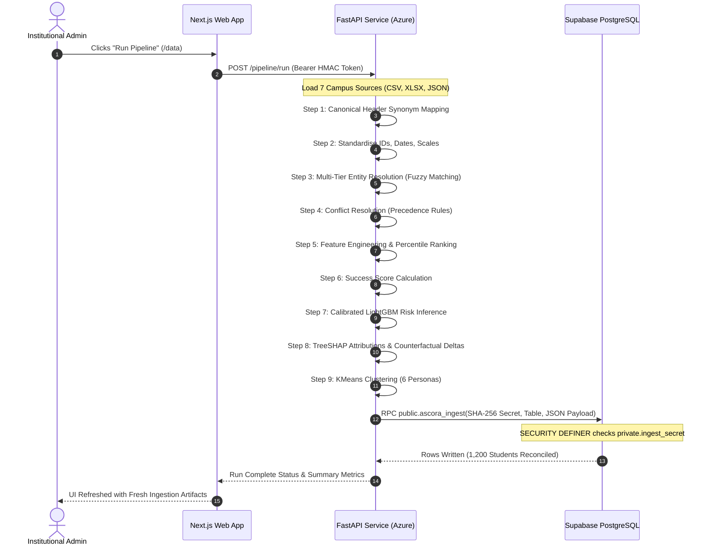

### 2. Role-Scoped Authentication & Scoped Record Retrieval

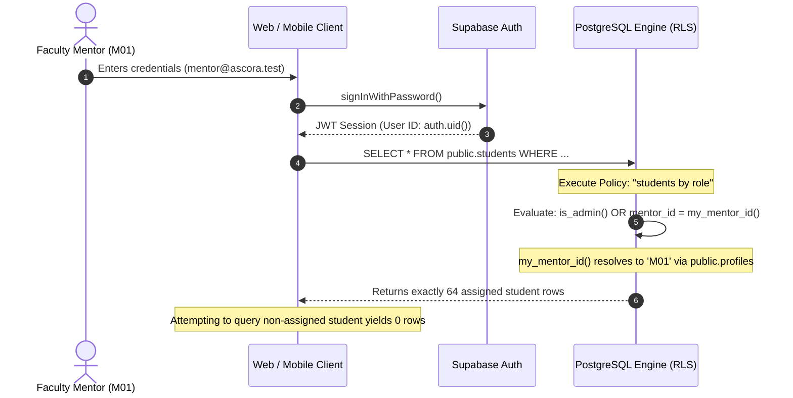

### 3. Closed-Loop Intervention Lifecycle

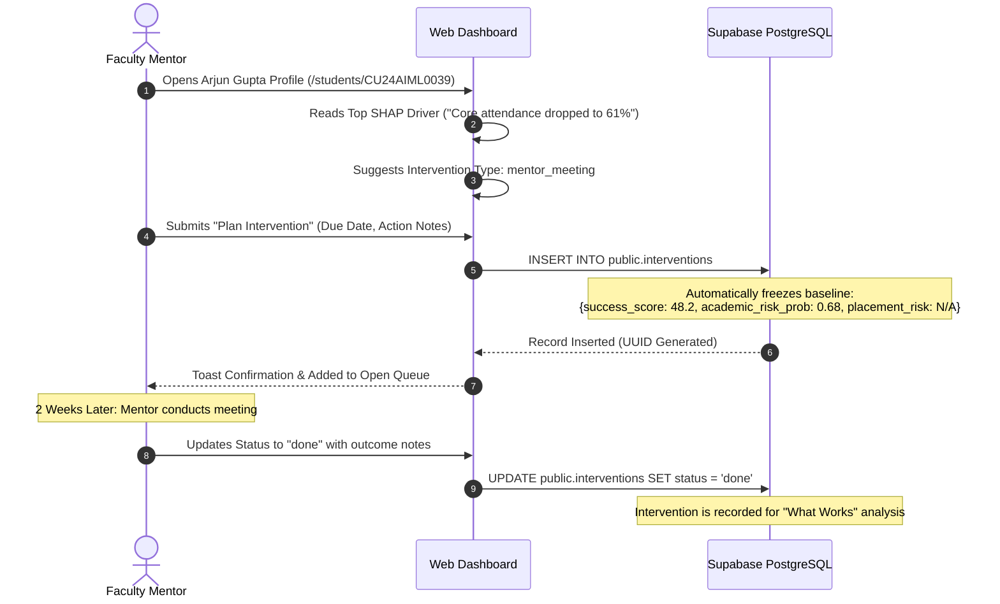

---

## 8. Technical Deep Dive: Making the Complexity Visible

### 8.1 Entity Resolution & Multi-Tier Matching

Real campus software exports rarely share a clean, universal foreign key. Ascora's entity resolution engine (`services/ml/app/clean/resolve.py`) applies a three-tier matching pipeline with blocking keys:

```
                          Incoming Student Record
                                     │
                        Has Canonical Roll Number?
                                    ╱ ╲
                             YES   ╱   ╲   NO
                                  ▼     ▼
                     Exact Roll Match   Has University Email?
                     (Confidence: 1.0)          ╱ ╲
                                         YES   ╱   ╲   NO
                                              ▼     ▼
                            Block on Programme    Block on Branch + Year;
                            + Token Sort Ratio    Fuzzy Name Match with
                            (Confidence: 0.75-0.95) Initials Normalisation
                                                   (Confidence: 0.60-0.92)
                                                        │
                         ┌──────────────────────────────┴──────────────────────────────┐
                         ▼                                                             ▼
           Confidence >= 0.90: Auto-Linked                               Confidence 0.75 - 0.89: Review Queue
           Linked directly to canonical profile                          Routed to source_links for human audit
```

- **Planted Benchmark Performance:** Evaluated against planted ground truth (`data/demo/_truth_links.parquet`), the matching algorithm achieves **100% precision** on auto-linked records and **95.29% recall**.
- **Conflict Precedence:** Discrepancies between sources are resolved via domain-specific precedence rules stored in `services/ml/app/config.py`:
  - Attendance percentages: `attendance_register` is authoritative over ERP batch exports.
  - Student Branch: Resolved via majority vote across ERP, Placement, LMS, and Clubs files.
  - Canonical Legal Name: `erp_academics` admission records override informal names.

---

### 8.2 Mathematical Formulation of the Student Success Score

The **Student Success Score** is a defensible metric from 0 to 100 designed to rank administrative attention without stigmatizing students.

#### Step 1: Cohort Percentile Transformation
Every raw indicator is transformed into a cohort percentile ranking $P(x) \in [0, 100]$:
$$P(x) = \frac{\text{rank}(x) - 1}{N - 1} \times 100$$
This eliminates non-linear distribution distortions between distinct academic branches (e.g. comparing grading curves between Mechanical Engineering and Computer Science).

#### Step 2: Component Synthesis
Percentile indicators are averaged into 6 core components:
1. **Academic (30%):** CGPA (50%), Current Internal Marks (30%), Internal Marks Trend vs. Historical Average (20%). Active backlogs incur a penalty of $-8.0$ points each, capped at $-24.0$ points.
2. **Placement Readiness (20%):** Aptitude Score (30%), Coding Assessment Score (30%), Mock Interviews Attended (20%), Mock Interview Rating (20%). If a student has never visited the placement cell, a neutral baseline of 15.0 is applied and labeled "no data" in the interface.
3. **Attendance (15%):** Overall Attendance (50%), Core-Subject Attendance (50%).
4. **LMS Activity (15%):** Weekly Logins (35%), Assignment Completion Rate (45%), Login Trend Slope (20%).
5. **Skills Assessment (10%):** Technical Coding Assessments (50%), Soft-Skill Evaluations (50%).
6. **Campus Engagement (10%):** Weighted participation index: Hackathons ($\times 3$), Certifications ($\times 2$), Technical Workshops ($\times 1$), Registered Clubs ($\times 1$).

$$\text{Success Score} = 0.30A + 0.20P + 0.15Att + 0.15LMS + 0.10S + 0.10E$$

#### Step 3: Sensitivity & Stability Verification
To prove the score is not an arbitrary artifact of weight tuning, 12 sensitivity scenarios were evaluated by perturbing each component weight by $\pm 5\%$ (renormalized).
- **Minimum Rank Correlation:** **0.997** across all 12 scenarios.
- **Bottom Quartile Retention:** **96%** of the bottom 100 students remained identical across all permutations.

---

### 8.3 Dual Risk Models vs. Logistic Baselines

Ascora decouples academic risk from placement risk. Predicting career unreadiness for an entrepreneurship-track student causes inappropriate panic; similarly, conflating academic backlog risk with coding aptitude obscures root causes.

```
┌──────────────────────────────┬──────────────────────────────┬──────────────────────────────┐
│ Model Specification          │ Academic Failure Risk        │ Placement Unreadiness Risk   │
├──────────────────────────────┼──────────────────────────────┼──────────────────────────────┤
│ Target Outcome               │ Semester failure or backlog  │ Unplaced by final year       │
│ Eligible Cohort Scope        │ All 1,200 Students           │ Placement-Intent Only (734)  │
│ Algorithm                    │ Calibrated LightGBM (Trees)  │ Calibrated LightGBM (Trees)  │
│ Held-Out ROC-AUC             │ **0.881**                    │ **0.802**                    │
│ 5-Fold Cross Validation AUC  │ **0.870**                    │ **0.839**                    │
│ Logistic Regression Baseline │ 0.875 ROC-AUC                │ 0.806 ROC-AUC                │
│ Precision @ Top 50 Ranked    │ **0.78**                     │ **0.62**                     │
│ High Threshold Cut-Off       │ Probability >= 0.50          │ Probability >= 0.60          │
│ Medium Threshold Cut-Off     │ Probability >= 0.25          │ Probability >= 0.35          │
└──────────────────────────────┴──────────────────────────────┴──────────────────────────────┘
```

> [!IMPORTANT]
> **Scientific Integrity Disclosure:** On this synthetic dataset, the simple logistic regression baseline performs nearly as well as the gradient-boosted tree model (0.875 vs. 0.881). Ascora documents this openly. The primary justification for deploying LightGBM is its ability to generate per-student **TreeSHAP** explanations and support multi-variable non-linear counterfactual queries, rather than a marginal gain in raw classification accuracy.

---

### 8.4 Local Explainability via TreeSHAP & Actionable Recourse

Black-box probability outputs alienate mentors. Ascora integrates `shap.TreeExplainer` directly into the inference pipeline:

1. **Local Attribution Calculation:**
   For student $x$, the model decomposes prediction $f(x)$ into additive feature contributions:
   $$f(x) = \phi_0 + \sum_{i=1}^{M} \phi_i(x)$$
   where $\phi_0$ is the base expected value and $\phi_i$ represents the attribution of feature $i$.
2. **Plain-Language Synthesis:**
   Raw Shapley values are transformed into clear statements:
   *"Core-subject attendance is 62% (cohort median: 78%), contributing +18 pts to academic risk."*
3. **Actionability Tagging:**
   Features are classified as either **Actionable** (attendance, assignment completion, mock interview participation) or **Contextual** (historical CGPA, entrance rank). Mentors are guided toward levers they can influence.
4. **Counterfactual Solver ("What Helps"):**
   The service computes the smallest positive delta $\Delta x_j$ on actionable features that reduces calibrated risk probability below the Medium threshold ($0.25$):
   $$\min \|\Delta x\|_2 \quad \text{s.t.} \quad P(y=1 \mid x + \Delta x) < 0.25$$

---

### 8.5 Mentor Knapsack Capacity Planner

Faculty mentors have limited advisory hours per week (typically 2 to 4 hours). If a mentor oversees 64 students, meeting every mentee is impossible. Ascora treats weekly planning as a **Bounded Knapsack Optimization**:

$$\max \sum_{i \in \text{Mentees}} \text{Priority}_i \cdot x_i \quad \text{subject to} \quad \sum_{i \in \text{Mentees}} \text{Duration}_i \cdot x_i \le H \times 60$$

- $\text{Priority}_i$: Calculated from composite risk probabilities, recent score trend decline, and active alert triggers.
- $\text{Duration}_i$: Standard meeting duration (e.g. 20 to 30 minutes based on intervention complexity).
- $H$: Available consultation hours configured on the `/this-week` interface.
- Solved dynamically via a greedy knapsack algorithm in `apps/web/src/app/(app)/this-week/planner.tsx`.

---

### 8.6 Natural Language Query Translation (Ask Ascora)

To allow administrators to query the campus database conversationally without risking SQL injection, Ascora's **Ask Ascora** feature (`services/ml/app/insights/ask.py`) enforces strict validation:

```
  User Query: "Show me 3rd year CSE students with high academic risk and attendance below 65%"
                                      │
                                      ▼
                        Azure OpenAI (gpt-4.1-mini)
                   Prompted with strict JSON Schema hint
                                      │
                                      ▼
               Structured Pydantic Model Validation (Query & Filter)
                   Rejects unknown fields, enforces closed enums
                                      │
            ┌─────────────────────────┴─────────────────────────┐
            ▼                                                   ▼
     Validation PASSES                                  Validation FAILS
     Query translated to PostgREST                      Falls back to deterministic
     client filter parameters                           keyword / regex parser
            │                                                   │
            └─────────────────────────┬─────────────────────────┘
                                      ▼
                      Supabase Executes Scoped Query
```

---

## 9. Technology Stack

A rigorous, modern stack selected to ensure high developer velocity, strict typing, and separation of concerns.

| Layer | Technology | Version | Purpose in Ascora |
| :--- | :--- | :--- | :--- |
| **Frontend Framework** | Next.js | `15.5.27` | React Server Components, App Router, authenticated layouts, streaming data access. |
| **Frontend UI Core** | React | `19.1.0` | Declarative UI rendering, concurrent features, component lifecycles. |
| **Mobile Runtime** | React Native | `0.86.3` | Native cross-platform mobile companion runtime. |
| **Mobile Toolchain** | Expo SDK | `57.0.28` | Expo Router file-based routing, Hermes JS engine, vector icons, splash screens. |
| **Styling & Design Tokens** | Tailwind CSS | `4.0` | Zero-runtime CSS design system, dark/light theme switching, CSS variables. |
| **Component Primitives** | shadcn/ui & Radix UI | Latest | Accessible dialogs, dropdowns, popovers, tooltips, and form inputs. |
| **Data Tables** | TanStack Table | `8.21.3` | Headless, virtualized, multi-column sorting and filtering for student rosters. |
| **Visualization** | Recharts & SVG | `3.10.1` | Radar diagrams, longitudinal attendance bars, and risk distribution charts. |
| **Backend Framework** | FastAPI | `1.0.0` | Asynchronous REST API service handling pipeline compute and what-if simulation. |
| **Data Processing** | Pandas & NumPy | `2.2 / 2.0` | Tabular data manipulation, canonicalization, matrix operations, percentile ranking. |
| **Machine Learning** | LightGBM | `4.3.0` | Gradient-boosted decision trees for dual-target risk prediction. |
| **Baseline Modeling** | Scikit-Learn | `1.4.2` | CalibratedClassifierCV, LogisticRegression, KMeans clustering, StandardScaler. |
| **Explainable AI** | SHAP | `0.45.0` | TreeSHAP local feature attribution and waterfall data generation. |
| **Fuzzy Matching** | RapidFuzz | `3.9.0` | High-performance C++ Levenshtein distance, token sort ratios for entity resolution. |
| **Database & Identity** | Supabase PostgreSQL | `15.1` | Relational storage, PostgREST API, Row-Level Security, Auth engine. |
| **LLM Provider** | Azure OpenAI Service | `gpt-4.1-mini` | Natural wording rephrasing and structured filter extraction (Korea Central). |
| **Web Hosting** | Vercel | Production | Global CDN, Edge middleware, serverless functions pinned to `hnd1` Tokyo. |
| **ML Service Hosting** | Azure App Service | Linux B1 | Dedicated Python 3.12 container runtime (`ascora-ml`, Central India). |
| **Automated Testing** | Pytest & Vitest | `8.0 / 5.0` | 36 ML integration/unit tests; 20 frontend calculator and format tests. |

---

## 10. Database Architecture

The relational architecture is governed by Supabase PostgreSQL. Multi-tenancy and data isolation are enforced directly in database engine policies rather than application code.

### Entity Relationship Diagram

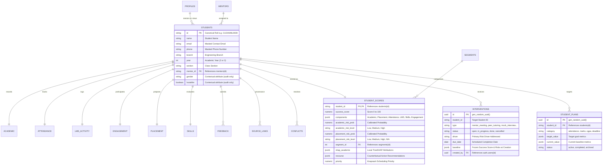

### Table Definitions & Architectural Design

| Table Name | Primary Key | Key Foreign Keys | Purpose & Design Decisions |
| :--- | :--- | :--- | :--- |
| `public.profiles` | `id` (UUID) | `auth.users(id)` | Maps authenticated Supabase credentials to application roles (`admin`, `mentor`, `student`) and assigned `mentor_id`. |
| `public.students` | `id` (Text) | `mentor_id -> mentors(id)` | Canonical demographic profile. Contextual variables (`gender`, `hosteller`, `lateral_entry`) are strictly isolated for fairness auditing and excluded from model features. |
| `public.student_scores` | `student_id` (Text) | `students(id)`, `segments(id)` | Analytical output store containing the 0-100 Success Score, calibrated risk probabilities, TreeSHAP JSON vectors, and knapsack priority weights. |
| `public.interventions` | `id` (UUID) | `created_by -> auth.users(id)` | Action tracking store. Does not have a strict FK to `students(id)` so intervention histories persist across synthetic cohort resets. |
| `public.source_links` | `id` (BigInt) | `students(id)` | Full data lineage recording source file, sheet, row number, matching method, and match confidence score. |
| `public.conflicts` | `id` (BigInt) | `students(id)` | Logs cross-source value discrepancies (e.g. ERP vs. Attendance register) and the automated precedence rule applied. |
| `public.student_plans` | `id` (UUID) | `students(id)` | Stores personal student commitments (attendance goals, terminal exam targets) created via collegiate calculators. |
| `public.audit_log` | `id` (BigInt) | `user_id -> auth.users(id)` | Append-only governance table recording student profile view events. |

### Row-Level Security (RLS) Mechanics

Supabase PostgreSQL tables have RLS enabled with strict policies evaluated through helper functions in the `private` schema:
- `is_admin()`: Returns `true` if `auth.uid()` has `role = 'admin'` in `public.profiles`.
- `my_mentor_id()`: Returns the assigned `mentor_id` string for the signed-in user.
- `can_see_student(sid)`: Evaluates whether the caller is an admin, the assigned mentor, or the student themselves.

```sql
-- Example RLS Policy on public.students
create policy "students by role" on public.students
for select to authenticated
using (
  public.is_admin()
  or mentor_id = public.my_mentor_id()
  or id = private.my_student_id()
);
```

#### Ingestion Protection via SHA-256 Token-Gated RPC
The external FastAPI ML service does not hold administrative database credentials. To write pipeline outputs, it calls `public.ascora_ingest(p_token, p_table, p_rows)`:
1. The database checks `private.ingest_secret` where only the `SHA-256` digest of the ingest token is stored.
2. The function runs as `SECURITY DEFINER`, allowing controlled batch upserts while preventing direct write access to public tables.

---

## 11. Security, Privacy, and DPDP Principles

Ascora is built in alignment with modern data protection principles, including India's **Digital Personal Data Protection (DPDP) Act 2023** framework.

```
┌────────────────────────────────────────────────────────────────────────┐
│                        DATA PROTECTION ARCHITECTURE                    │
├────────────────────────────────────────────────────────────────────────┤
│ 1. PURPOSE LIMITATION: Risk predictions exist solely to allocate       │
│    support resources. Scores are strictly hidden from student views.   │
├────────────────────────────────────────────────────────────────────────┤
│ 2. CONTACT DATA MINIMISATION: All student phone numbers and emails     │
│    are masked before display: "ar••••••@culko.in", "98••••••32".      │
├────────────────────────────────────────────────────────────────────────┤
│ 3. SENSITIVE ATTRIBUTE EXCLUSION: Gender, domicile, first-generation   │
│    status, and schooling medium are NEVER fed into ML models.          │
├────────────────────────────────────────────────────────────────────────┤
│ 4. ACCESS CONTROLLED AUDITING: Every profile inspection by a faculty   │
│    mentor triggers an append-only row in public.audit_log.             │
├────────────────────────────────────────────────────────────────────────┤
│ 5. NO ARBITRARY SQL VIA LLM: Natural language queries parse into       │
│    validated Pydantic models. Prompt injection cannot execute raw SQL. │
└────────────────────────────────────────────────────────────────────────┘
```

### Algorithmic Fairness Audit Findings
Ascora includes an automated algorithmic fairness auditor (`/fairness`) evaluating disparate impact across 10 demographic intersections. Using the standard 80% rule ($0.80$ flag-rate ratio threshold):
- **6 of 10 Demographic Checks Passed:** Disparate impact is within acceptable parity across branch divisions, schooling medium, and first-generation learners.
- **4 Checks Marked "Review Needed":**
  1. Domicile (Academic Risk): Day scholars exhibit slightly higher flag rates due to commute-related lecture absences.
  2. Gender (Placement Risk): Minor flag rate divergence in placement readiness.
  3. Lateral Entry (Academic & Placement): Lateral entry students (entering directly in Year 2) exhibit a flag-rate ratio of 0.77 against the 0.80 benchmark.

> [!NOTE]
> Ascora documents these 4 review flags openly in the dashboard rather than hiding them. In a real-world institutional deployment, these disparities require targeted structural support rather than algorithmic suppression.

---

## 12. Mobile Application and Android APK

The **Ascora Mobile Companion** (`apps/mobile`) provides mentors and administrators with on-the-go access to their mentee rosters and weekly planning tools.

<div align="center">
  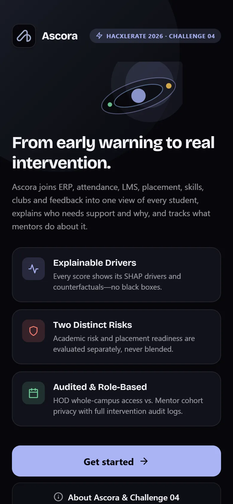
  <p><em>Ascora Mobile Companion: Home dashboard showing greeting, real-time cohort KPIs, week calendar strip, and prioritized mentee actions.</em></p>
</div>

### Native Android Release APK Specifications

An optimized release build is compiled for Android devices and hosted on Azure Blob Storage:

| Parameter | Verified Production Specification |
| :--- | :--- |
| **Direct Download URL** | [Download Ascora-1.0.0.apk](https://ascoradownloadseb0c.blob.core.windows.net/app/ascora-1.0.0.apk) |
| **Package / Application ID** | `com.ascora.mobile` |
| **Release Version** | `1.0.0` (Production Release) |
| **Bundle Size** | `61 MB` |
| **Target Architecture** | Android 7.0+ (API Level 24 and higher) |
| **JavaScript Engine** | Hermes Bytecode Engine |
| **Release SHA-256 Digest** | `de74a1f9985120774bea60f46e2165953e41897cf3b5866faa2938765112892e` |

### Testing in the Desktop Browser Simulator
For evaluators without an Android device, Ascora includes an interactive web simulator:
1. Navigate to [https://ascora-five.vercel.app/mobile](https://ascora-five.vercel.app/mobile).
2. The page renders the full, live React Native Expo bundle inside a realistic phone bezel.
3. Use the top device switcher to toggle between **iPhone 14 (390x844)**, **Android (360x800)**, and **Tablet (768x1024)** frame modes.
4. Interact directly with login, roster search, student profiles, and planning workflows.

### Running on Physical Devices via Expo Go
To test native haptics, gestures, and animations on a physical phone:
```bash
cd apps/mobile
npm install
cp .env.example .env   # Enter EXPO_PUBLIC_SUPABASE_URL and EXPO_PUBLIC_SUPABASE_ANON_KEY
npx expo start
```
Scan the terminal QR code using the **Expo Go** app on Android or iOS.

---

## 13. Project Structure

Ascora is maintained as a clean monorepo separating web, mobile, ML, data, and infrastructure:

```
Hackxelerate/
├── apps/
│   ├── mobile/                      # Expo / React Native Companion App
│   │   ├── app/                     # Expo Router file-based pages
│   │   │   ├── +html.tsx            # Web root & responsive simulator wrapper
│   │   │   ├── _layout.tsx          # Global AuthGate, font loaders, navigation stack
│   │   │   ├── sign-in.tsx          # Branded sign-in with 1-click demo role buttons
│   │   │   ├── (tabs)/              # 5-tab persistent bottom bar
│   │   │   │   ├── index.tsx        # Home: greeting, KPI cards, week strip, Meet First
│   │   │   │   ├── students.tsx     # Student Directory: search, risk chips, FlatList
│   │   │   │   ├── this-week.tsx    # Weekly Planner: greedy knapsack scheduler
│   │   │   │   ├── hub.tsx          # Platform Hub: Segments, models, fairness metrics
│   │   │   │   └── settings.tsx     # Theme toggle, motion preferences, sign out
│   │   │   ├── student/[id].tsx     # Student 360: ScoreRing, SHAP drivers, recourse
│   │   │   └── about.tsx            # KPMG Challenge 04 team credentials
│   │   ├── src/components/          # ScoreRing, RiskBadge, DriverList, LmsBarChart
│   │   └── src/lib/                 # Supabase client, theme tokens, formatters
│   │
│   └── web/                         # Next.js 15 Web Application
│       ├── public/assets/           # Tracked brand icons, logos, and UI webp captures
│       │   └── ui/                  # Verified screenshots of production pages
│       └── src/
│           ├── app/
│           │   ├── (app)/           # Protected dashboard routes (RLS session enforced)
│           │   │   ├── overview/    # Campus overview & 7-day agenda calendar
│           │   │   ├── students/    # Student directory & TanStack data table
│           │   │   │   └── [id]/    # Individual Student 360 & TreeSHAP breakdown
│           │   │   ├── this-week/   # Mentor knapsack capacity scheduler
│           │   │   ├── interventions/ # Closed-loop action tracker & What Works lift
│           │   │   ├── segments/    # KMeans cohort segmentation & 6 personas
│           │   │   ├── data/        # Data integration, cleaning audit, pipeline runner
│           │   │   ├── model/       # Score formulation & LightGBM metrics
│           │   │   ├── fairness/    # Disparate impact & DPDP compliance panel
│           │   │   ├── ask/         # Ask Ascora natural language interface
│           │   │   └── student/     # Student portal (calculator, schedule, connection)
│           │   ├── (site)/          # Public informational routes (about, trust, mobile)
│           │   └── login/           # Authentication portal with quick demo buttons
│           ├── components/          # Reusable UI primitives, AppShell, Motion wrappers
│           └── lib/                 # Supabase server/browser clients, formatters, offline
│
├── services/
│   └── ml/                          # FastAPI ML & Data Processing Service
│       ├── app/
│       │   ├── clean/               # Normalisation, entity resolution, conflict rules
│       │   ├── ingest/              # Canonical header mapping & file parsers
│       │   ├── models/              # LightGBM risk models, KMeans personas, calibration
│       │   ├── scoring/             # Student Success Score, TreeSHAP explainer, recourse
│       │   ├── insights/            # Ask Ascora query parser, LLM connectors
│       │   ├── pipeline.py          # 10-stage sequential orchestration pipeline
│       │   └── main.py              # FastAPI HTTP endpoints (/whatif, /ask, /pipeline)
│       └── tests/                   # 36 Pytest automated tests
│
├── data/
│   ├── demo/                        # Frozen benchmark cohort (1,200 students, 7 sources)
│   └── generator/                   # Synthetic data generator script (seed 42)
│
├── supabase/
│   └── migrations/                  # Versioned SQL migrations (0001 through 0006)
│       ├── 0001_schema.sql          # Core tables, indexes, RLS policies, ingest RPC
│       ├── 0004_harden_rls.sql      # Private schema helper hardening
│       └── 0006_student_portal.sql  # Student accounts, personal plans, external connect
│
├── docs/                            # In-depth architectural & evaluation documentation
│   ├── architecture.md              # Technical system design
│   ├── score-note.md                # Mathematical deliverable for Success Score
│   ├── REQUIREMENTS_MATRIX.md       # Audit of challenge requirements
│   ├── EVALUATION_SCORECARD.md      # Self-evaluation against KPMG rubric
│   └── DEMO_SCRIPT.md               # 8-step evaluator verification script
│
└── .github/workflows/               # GitHub Actions CI/CD pipelines
    ├── ci.yml                       # Lint, typecheck, unit tests, secret scanning
    └── deploy-ml.yml                # Azure App Service fast zip deploy
```

---

## 14. Installation and Local Setup

### Prerequisites
- **Node.js:** `v22.x` or higher
- **Python:** `3.12.x`
- **Package Managers:** `npm` (v10+), `uv` (recommended) or standard `pip`
- **Git**

```bash
git clone https://github.com/taqi-ai/Hackxelerate.git
cd Hackxelerate
```

---

### Step 1: Start the ML Service (`services/ml`)

```bash
cd services/ml

# Create and activate virtual environment
python -m venv .venv
# Windows PowerShell:
.venv\Scripts\Activate.ps1
# macOS / Linux:
source .venv/bin/activate

# Install dependencies (fast install via uv or pip)
pip install -r requirements.txt

# Configure environment variables
cp .env.example .env
# Edit .env with your Supabase credentials or keep defaults for local computation

# Run the 36 automated verification tests
python -m pytest -q

# Run pipeline locally and refresh offline snapshot (no database writes required)
python scripts/publish_demo.py --no-publish

# Start the FastAPI development server on port 8000
python -m uvicorn app.main:app --port 8000 --reload
```

---

### Step 2: Start the Web Dashboard (`apps/web`)

```bash
cd apps/web

# Install dependencies
npm install

# Configure environment variables
cp .env.example .env.local
# Fill in NEXT_PUBLIC_SUPABASE_URL and NEXT_PUBLIC_SUPABASE_ANON_KEY

# Option A: Run against live Supabase
npm run dev
# Opens http://localhost:3000

# Option B: Run in Offline Demo Mode ("Venue Insurance Mode")
# Runs entirely from local snapshot with zero internet or Supabase dependency
npm run dev:offline
```

---

### Step 3: Start the Mobile Companion App (`apps/mobile`)

```bash
cd apps/mobile

# Install dependencies
npm install

# Configure environment variables
cp .env.example .env
# Fill in EXPO_PUBLIC_SUPABASE_URL and EXPO_PUBLIC_SUPABASE_ANON_KEY

# Option A: Run interactive browser simulator on port 8082
npm run web
# Opens http://localhost:8082 with interactive phone frame

# Option B: Run with Expo Go on a physical phone
npx expo start
```

---

### Environment Variable Reference

#### Web Application (`apps/web/.env.local`)
```env
NEXT_PUBLIC_SUPABASE_URL=https://YOUR_SUPABASE_PROJECT.supabase.co
NEXT_PUBLIC_SUPABASE_ANON_KEY=YOUR_SUPABASE_PUBLIC_ANON_KEY
NEXT_PUBLIC_ML_API_URL=http://localhost:8000
ASCORA_TOKEN_SECRET=your-shared-hmac-secret-for-ml-calls
```

#### ML Service (`services/ml/.env`)
```env
SUPABASE_URL=https://YOUR_SUPABASE_PROJECT.supabase.co
SUPABASE_ANON_KEY=YOUR_SUPABASE_PUBLIC_ANON_KEY
ASCORA_INGEST_TOKEN=your-random-token-matching-sha256-in-private-schema
ASCORA_TOKEN_SECRET=your-shared-hmac-secret-for-ml-calls
AZURE_OPENAI_ENDPOINT=https://ascora-ai-koreacentral.openai.azure.com/
AZURE_OPENAI_KEY=your-azure-openai-key-optional
ALLOWED_ORIGINS=http://localhost:3000,http://localhost:8082,https://ascora-five.vercel.app
```

#### Mobile Companion (`apps/mobile/.env`)
```env
EXPO_PUBLIC_SUPABASE_URL=https://YOUR_SUPABASE_PROJECT.supabase.co
EXPO_PUBLIC_SUPABASE_ANON_KEY=YOUR_SUPABASE_PUBLIC_ANON_KEY
```

---

## 15. Testing and Verification

Ascora includes rigorous automated test suites guarding against regressions, typing inconsistencies, and security flaws.

```
┌────────────────────────────────────────────────────────────────────────┐
│                        QUALITY & VERIFICATION GATES                    │
├───────────────────────┬──────────────┬──────────────────┬──────────────┤
│ Test Suite            │ Target       │ Execution        │ Verified     │
├───────────────────────┼──────────────┼──────────────────┼──────────────┤
│ ML Pipeline & Math    │ services/ml  │ pytest -q        │ 36 passed    │
│ Frontend Calculators  │ apps/web     │ npm test         │ 20 passed    │
│ TypeScript Typecheck  │ apps/web     │ npx tsc --noEmit │ 0 errors     │
│ Mobile Typecheck      │ apps/mobile  │ npm run typecheck│ 0 errors     │
│ Code Style & Lint     │ Entire Repo  │ npm run lint     │ 0 errors     │
│ Static Build          │ apps/web     │ npm run build    │ 29 compiled  │
│ Security Secret Scan  │ Git History  │ gitleaks-action  │ 0 secrets    │
│ Accessibility         │ 15 Routes    │ axe-core WCAG AA │ Clean        │
└───────────────────────┴──────────────┴──────────────────┴──────────────┘
```

### Running Test Suites Locally

```bash
# 1. Run ML service tests (36 tests verifying normalisation, entity resolution, scoring, calibration)
cd services/ml
python -m pytest -q

# 2. Run web unit tests (20 tests covering academic calculators, date math, formatters)
cd apps/web
npm test

# 3. Verify static types across web and mobile
cd apps/web && npx tsc --noEmit
cd apps/mobile && npm run typecheck

# 4. Verify code linting
cd apps/web && npm run lint
cd apps/mobile && npm run lint
```

---

## 16. Engineering Trade-offs and Scalability

Every architectural choice in Ascora represents a deliberate engineering trade-off:

```
┌────────────────────────────────────────────────────────────────────────┐
│                   ARCHITECTURAL TRADE-OFF DECISIONS                    │
├───────────────────────────────────┬────────────────────────────────────┤
│ Decision Taken                    │ Engineering Rationale & Trade-off  │
├───────────────────────────────────┼────────────────────────────────────┤
│ 1. Direct Web-to-PostgreSQL via   │ Eliminates redundant backend proxy │
│    Supabase PostGREST & RLS       │ boilerplate. Trade-off: access     │
│                                   │ rules must live strictly in SQL.   │
├───────────────────────────────────┼────────────────────────────────────┤
│ 2. Offloading Compute to Azure    │ Serverless Next.js functions time  │
│    App Service (B1 Linux)         │ out on heavy LightGBM and SHAP runs│
│                                   │ Heavy compute stays isolated.      │
├───────────────────────────────────┼────────────────────────────────────┤
│ 3. Precomputed TreeSHAP Vectors   │ Real-time TreeSHAP on 1,200 records│
│    Stored in JSONB Columns        │ takes ~4 seconds. Precomputing     │
│                                   │ enables sub-50ms Student 360 loads.│
├───────────────────────────────────┼────────────────────────────────────┤
│ 4. Deterministic Rule Fallbacks   │ Eliminates hard cloud dependencies.│
│    for Natural Language Queries   │ Ascora functions seamlessly even if│
│                                   │ Azure OpenAI credits expire.       │
└───────────────────────────────────┴────────────────────────────────────┤
```

### Institutional Scaling Considerations
In a production deployment supporting 20,000+ students across multiple colleges:
- **Database Partitioning:** The `academic`, `attendance`, and `lms_activity` tables can be partitioned by `academic_year` and `branch`.
- **Asynchronous Ingestion:** Pipeline execution can be moved from synchronous HTTP requests to an asynchronous Celery or Azure Service Bus worker pool.
- **Incremental SHAP Inference:** Rather than recomputing explanations across the entire campus, calculate SHAP vectors incrementally only for students whose component indicators shifted by $> 3\%$.

---

## 17. Limitations and Realistic Roadmap

Ascora takes pride in scientific honesty and transparent communication:

### Current Project Limitations
1. **Synthetic Data Context:** While the synthetic cohort contains deliberately planted real-world data quality issues (typos, duplicates, scale mismatches, dropouts), model precision and AUC describe this synthetic benchmark. Institutional deployment requires re-calibration on historic college records.
2. **Compute Sizing:** The ML service runs on a single Azure B1 instance (1 vCPU, 1.75 GB RAM). A cold pipeline execution takes ~4 minutes there (compared to 25 seconds on a development laptop). Repeat runs reuse cached state artifacts.
3. **Fairness Review Flags:** Four group checks in the fairness panel (lateral entry, residence) exhibit flag ratios below 0.80 and require institutional oversight before high-stakes deployment.

### Realistic Feature Roadmap

```
  ┌────────────────────────────────────────────────────────────────────────┐
  │                           ASCORA ROADMAP                               │
  ├────────────────────────────────────────────────────────────────────────┤
  │ [x] COMPLETED                                                          │
  │     - 7-source integration pipeline with fuzzy entity resolution       │
  │     - Multi-dimensional Student Success Score with stability audit     │
  │     - Dual calibrated LightGBM risk models with TreeSHAP explanations   │
  │     - Next.js 15 web dashboard with RLS role-based security            │
  │     - Mentor knapsack capacity planner & closed-loop interventions     │
  │     - Mobile companion app (Expo / React Native) with browser simulator│
  │     - Offline demo mode ("Venue Insurance") and automated CI/CD        │
  ├────────────────────────────────────────────────────────────────────────┤
  │ [/] IN PROGRESS                                                        │
  │     - Bi-directional LMS assignment webhook sync (Canvas / Moodle LTI) │
  │     - Automated WhatsApp notification digests for faculty mentors      │
  │     - Multi-department administrative hierarchy rollouts               │
  ├────────────────────────────────────────────────────────────────────────┤
  │ [ ] PLANNED FUTURE MILESTONES                                          │
  │     - Institutional accreditation compliance reporting (NAAC & NBA)    │
  │     - Supplementary exam scheduling & remedial class optimizer         │
  │     - Federated learning across participating university campuses      │
  └────────────────────────────────────────────────────────────────────────┘
```

---

## 18. Visual Showcase

Actual interfaces captured from the verified production environment:

<br />

### 1. Campus Overview & Institutional Analytics (`/overview`)
*Executive command center featuring macro health indicators, score distribution histograms, and the interactive 7-day rolling agenda calendar.*
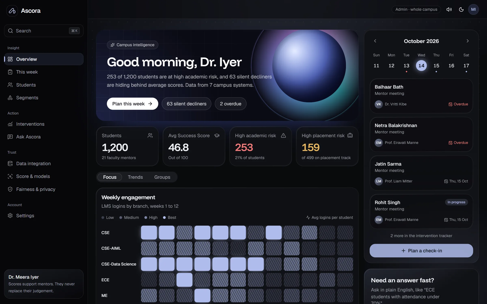

<br />

### 2. Student 360 & Explainable AI (`/students/[id]`)
*Longitudinal student profile showing the 6-component diagnostic radar, plain-language TreeSHAP positive and negative drivers, and interactive counterfactual sliders.*
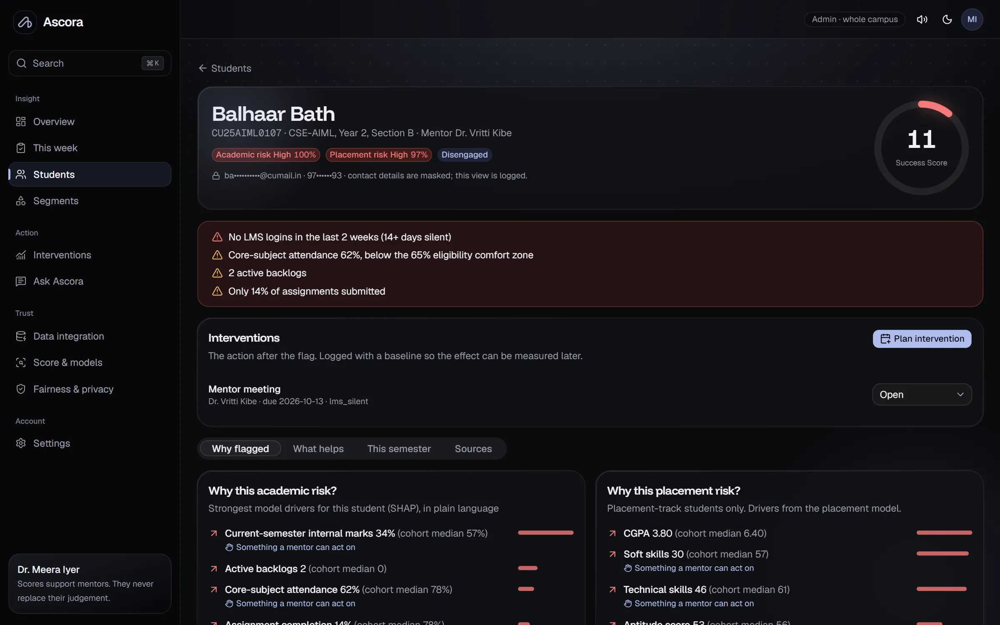

<br />

### 3. Mentor Weekly Capacity Planner (`/this-week`)
*Knapsack-optimized scheduling workspace that matches available faculty consultation hours to the highest-priority students with treatable drivers.*
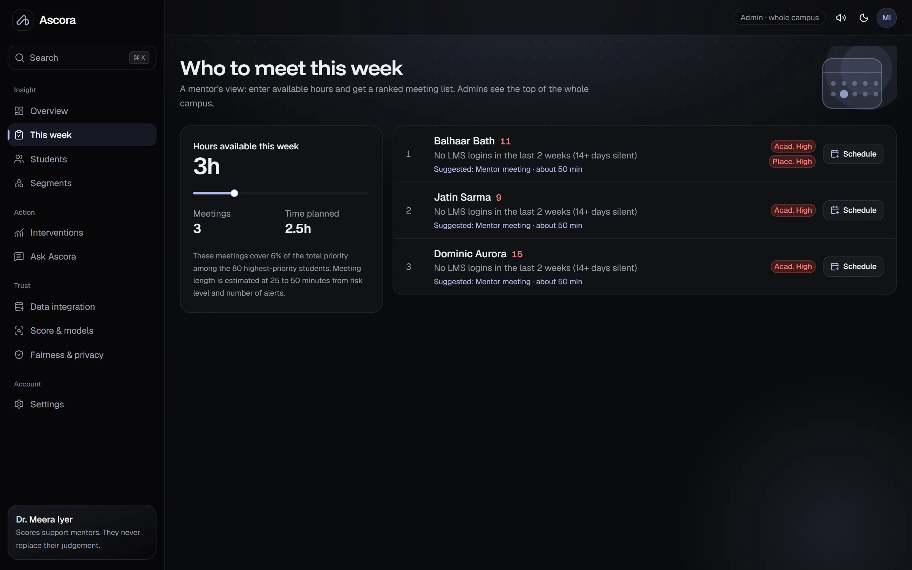

<br />

### 4. Cohort Behavioral Segmentation (`/segments`)
*KMeans clustering interface identifying 6 actionable personas across the campus, including Silent Decliners and High Academics / Low Readiness students.*
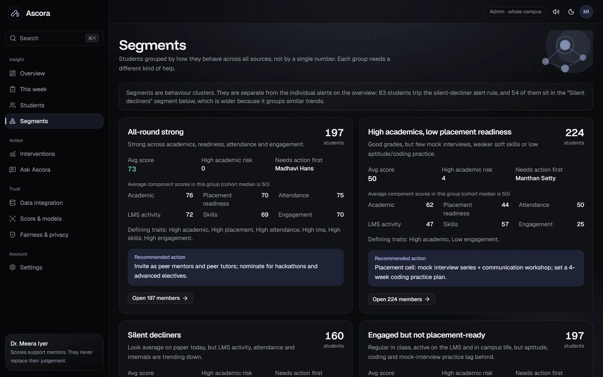

<br />

### 5. Model Methodology & Algorithmic Fairness (`/model` & `/fairness`)
*Transparent disclosure of scoring weights, calibration curves, held-out LightGBM ROC-AUC metrics, and demographic parity evaluations.*
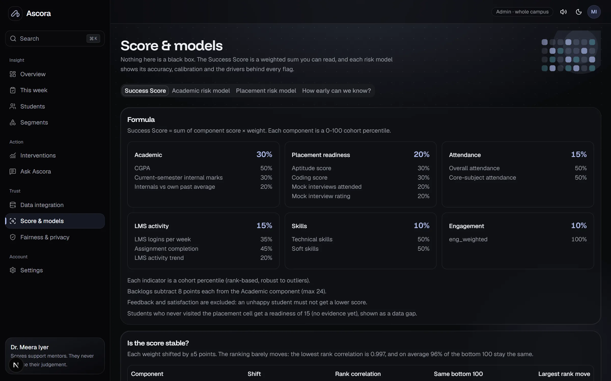

<br />

### 6. Institutional Data Integration & Quality Auditor (`/data`)
*Data integration pipeline showing multi-source file reconciliation, automated conflict resolution counts, and fuzzy entity match accuracy.*
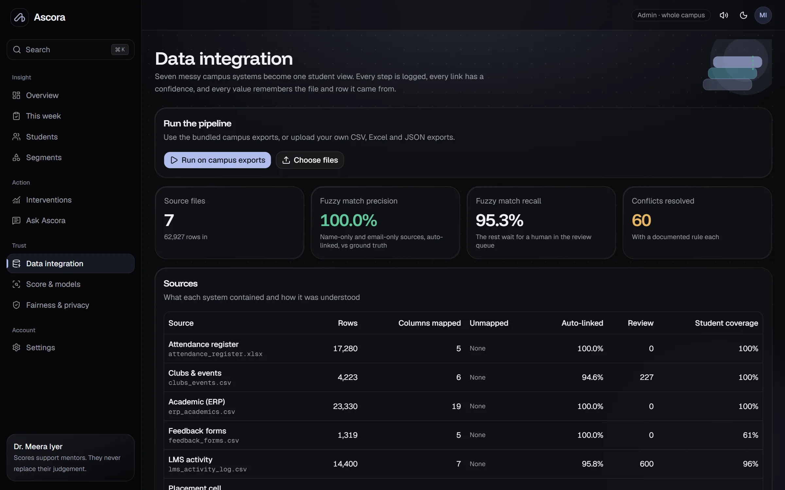

---

## 19. Developer Guide and Contribution Workflow

### Engineering Conventions
1. **Branching Strategy:** Never push directly to `main`. Create scoped branches using the convention `gemini/<task-name>`, `claude/<task-name>`, or `feature/<task-name>`.
2. **Handoff Tracking:** Ascora uses `docs/HANDOFF.md` to track inter-agent and team handoffs. Before starting a task, verify the file and append your status upon completion.
3. **Database Protection:** Never modify existing SQL migrations in `supabase/migrations/`. Always add an incremental migration file (`0007_name.sql`).
4. **Copy & Typography:** No em-dashes in user-facing text. No emojis in production interfaces. Maintain strict OKLCH design tokens.

### Verification Checklist Before Opening a Pull Request
- [ ] `services/ml`: `pytest -q` passes all 36 tests.
- [ ] `apps/web`: `npx tsc --noEmit` and `npm run lint` report 0 errors.
- [ ] `apps/web`: `npm test` passes all 20 Vitest unit tests.
- [ ] `apps/mobile`: `npm run typecheck` and `npm run lint` report 0 errors.
- [ ] Git working tree is clean; no secrets or `.env` files staged.

---

## 20. License and Project Credits

### KPMG in India Challenge 04 Attribution
Ascora was conceived, designed, and engineered for the **KPMG in India Smart Campus Analytics Challenge (Challenge 04)** at **HacXLerate 2026**, organized by **byteXL**.

### Core Engineering Team (CU UP Campus)
All team members are second-year B.Tech students specializing in Artificial Intelligence and Machine Learning (AIML, Semester 3):

- **Taqi** - Team Lead & Architect: Product direction, data pipeline architecture, machine learning models, web platform, and deployment.
- **Ashmit Tiwari** - Brand & Marketing: Brand identity, logo teaser, user experience styling, and value proposition articulation.
- **Harsh Gupta** - Brand & Marketing: UI visual aesthetics, promotional graphics, and institutional presentation design.
- **Lakshya Singh Parihar** - Frontend Engineering: Next.js frontend components, data visualizations, and student directory workflows.
- **Ujjwal Gupta** - Backend & Mobile Engineering: Backend integrations, data flow hardening, and the React Native / Expo Android mobile companion.

### Repository License Notice
This repository contains proprietary competition deliverables developed for HacXLerate 2026. The mobile companion source code in `apps/mobile/` includes an MIT License header (`apps/mobile/LICENSE`). For all other modules, rights are reserved by the development team and Hackathon organizers.

---

<div align="center">

**"Most early-warning systems stop at the red flag. Ascora is built for what happens after it."**

<br />

[Back to Top](#ascora)

</div>
