# Ascora architecture

```mermaid
flowchart LR
  subgraph Sources["7 campus systems (CSV, Excel, JSON)"]
    A1[ERP academics]:::s
    A2[Attendance register]:::s
    A3[LMS activity log]:::s
    A4[Clubs and events]:::s
    A5[Placement cell]:::s
    A6[Skills assessment]:::s
    A7[Feedback forms]:::s
  end

  subgraph ML["ML and data service (FastAPI, Python 3.12)"]
    P1[Ingest and header auto-mapping]
    P2[Standardise IDs, names, dates, scales]
    P3[Entity resolution with confidence]
    P4[Dedupe and conflict rules]
    P5[Unified view with lineage]
    P6[Feature engineering]
    P7[Success Score]
    P8[Risk models and SHAP]
    P9[Segments, alerts, recourse]
    P10[Insights and fairness audit]
  end

  subgraph Supabase["Supabase"]
    DB[(Postgres with RLS)]
    AU[Auth: admin and mentor]
  end

  subgraph Web["Next.js on Vercel"]
    UI[Dashboard, Student 360, Ask Ascora]
    SA[Server actions: interventions]
  end

  LLM[(Gemini Flash, optional, cached)]

  Sources --> P1 --> P2 --> P3 --> P4 --> P5 --> P6 --> P7 --> P8 --> P9 --> P10
  P10 -->|token-gated RPC| DB
  UI -->|session cookie, RLS| DB
  AU --> UI
  UI -->|what-if, run pipeline, ask| ML
  SA --> DB
  P10 -.wording only.-> LLM
  classDef s fill:#eef,stroke:#88a;
```

## Components

| Part | Technology | Why |
|---|---|---|
| Web | Next.js 15 (App Router), TypeScript, Tailwind 4, shadcn/ui, Recharts, TanStack Table | Server-rendered pages read Supabase directly under the user's session |
| Auth and data | Supabase Postgres, Auth, row-level security | Mentors see only their own students, enforced in the database, not the UI |
| ML service | FastAPI, pandas, rapidfuzz, scikit-learn, LightGBM, SHAP | All heavy compute lives here, never on Vercel |
| LLM | Gemini Flash via `google-genai`, optional | Wording only (insight sentences, question-to-filter). Never in the scoring path. Cached; deterministic fallback when absent |

## Data flow

1. **Ingest.** Headers are matched to a canonical schema by synonym dictionary plus fuzzy matching. Title rows above merged headers in Excel are detected and skipped.
2. **Standardise.** Four roll-number formats become one ID; names, emails, dates (three formats) and score scales (0-10 vs 0-100) are normalised; impossible values are blanked, not guessed.
3. **Entity resolution.** Roll numbers match exactly. Email-only sources are blocked by programme (branch and batch) and name-matched. Name-only sources are blocked by branch and year, then fuzzy-matched with initials handled. Every link gets a confidence. At or above 0.90 it is auto-accepted, from 0.75 it goes to a review queue, below that it is rejected. Two near-identical candidates are capped into review rather than guessed.
4. **Conflicts.** Attendance disagreements over 5 points use the register as source of truth; branch uses a majority vote across sources. Each is stored with both values and the rule applied.
5. **Unified view.** One row per student, with `lineage` (file, sheet, row) for each value.
6. **Intelligence.** Features, Success Score, two risk models with SHAP, KMeans segments named by a rule layer, alerts, counterfactual recourse, goal-specific readiness, mentor priority, fairness audit, early-warning curve, what-works analysis, cross-source insights.
7. **Publish.** The service calls a `SECURITY DEFINER` RPC protected by a shared secret (only its SHA-256 is stored in a private schema). The service never holds the Supabase service-role key.

## Security and privacy

- Row-level security on every table; helper functions live in a private schema, not the exposed API.
- Mentors cannot read other mentors' students, scores, interventions or feedback. Verified by impersonating each role in SQL: admin sees 1,200 students, mentor M01 sees 64, a signed-out visitor sees 0.
- Contact details are masked in lists and profiles; every profile view is written to `audit_log`.
- Sensitive attributes (gender, residence, first-generation, lateral entry, schooling medium) are never model inputs.
- Offline demo mode skips auth, so it is refused on Vercel (`process.env.VERCEL`) and exists for a local laptop only.

## Resilience

- The UI works with the LLM disabled (deterministic text) and with the ML service down (precomputed recommendations stay; what-if shows an explanation).
- Offline demo mode serves the whole product from a local JSON snapshot, for bad venue Wi-Fi.
- The CORS policy allows only the configured origins and `ascora*.vercel.app` previews.

## Known limitations

- ML service deployment to Azure is a separate step (not done yet); until then the live site reads published data and the pipeline and what-if run locally.
- Synthetic data only.
